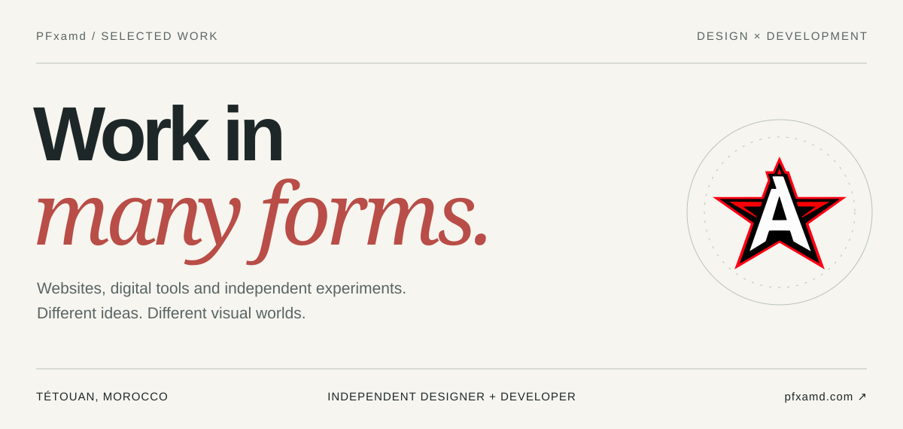
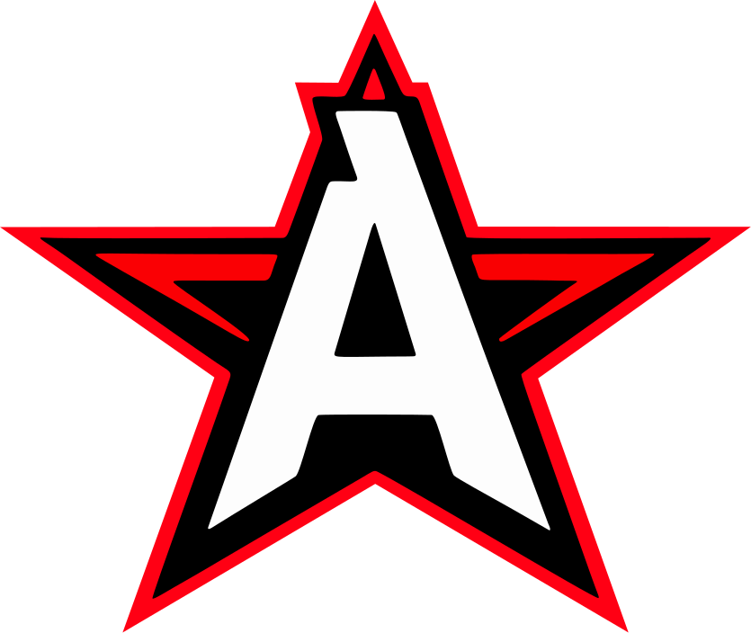

<a href="https://www.pfxamd.com/">
<picture>
<source media="(prefers-color-scheme: dark)" srcset="./assets/exhibition-dark.svg">

</picture>
</a>

I design and develop websites, digital tools and interactive experiences. Each project starts with its own idea — and finds its own visual language.

[**Enter the exhibition ↗**](https://www.pfxamd.com/) &nbsp; · &nbsp; [Tools & experiments](https://www.pfxamd.com/lab)

 

## 01 — Selected work

Client commissions and independent concepts, brought together.

<table>
<tr>
<td width="50%" valign="top">

01 / CLIENT WORK

<h3>Joury Flowers</h3>

A floral storefront with a personal touch.

<a href="https://jouryflowers.com/">Explore ↗</a> &nbsp; · &nbsp; <a href="https://github.com/pfxamd/jouryflowers">Source</a>

</td>
<td width="50%" valign="top">

02 / CLIENT WORK

<h3>Amarti Events</h3>

An editorial world for celebrations and decoration.

<a href="https://amarti-events.pages.dev/">Explore ↗</a> &nbsp; · &nbsp; <a href="https://github.com/pfxamd/Amarti-Events">Source</a>

</td>
</tr>
<tr>
<td width="50%" valign="top">

03 / INDEPENDENT CONCEPT

<h3>DAR SERA</h3>

An imagined guesthouse. Quiet spaces, warm materials.

<a href="https://pfxamd.github.io/dar-sera/">Explore ↗</a> &nbsp; · &nbsp; <a href="https://github.com/pfxamd/dar-sera">Source</a>

</td>
<td width="50%" valign="top">

04 / INDEPENDENT CONCEPT

<h3>IONRUSH</h3>

A fictional electric racing championship in Morocco.

<a href="https://pfxamd.github.io/IONRUSH/">Explore ↗</a> &nbsp; · &nbsp; <a href="https://github.com/pfxamd/IONRUSH">Source</a>

</td>
</tr>
</table>

### More worlds to explore

[**KINETONE**](https://pfxamd.github.io/KINETONE/) — Electronic instruments & a browser sound playground.  
[**MESA**](https://pfxamd.github.io/MESA/) — Recipes, photography & an independent culinary journal.  
[**SPLAY**](https://pfxamd.github.io/SPLAY/) — Variable type, kinetic specimens & a poster maker.

 

## 02 — Tools & experiments

Small interfaces. Useful ideas. Built for the browser.

| Project | Explore |
| :--- | :--- |
| **PFx Colors** · Color exploration & palettes | [Open ↗](https://pfxamd.github.io/pfx-colors/) · [Source](https://github.com/pfxamd/pfx-colors) |
| **PFx Interaction Playground** · Pointer interactions | [Open ↗](https://pfxamd.github.io/pfx-interaction-playground/) · [Source](https://github.com/pfxamd/pfx-interaction-playground) |
| **PFx CSS Motion** · Animation composition | [Open ↗](https://pfxamd.github.io/PFx-CSS-Motion/) · [Source](https://github.com/pfxamd/PFx-CSS-Motion) |

[Visit the lab ↗](https://www.pfxamd.com/lab)

 

---

**Design & development, by PFxamd.**  
[Tétouan, Morocco · pfxamd.com ↗](https://www.pfxamd.com/)
